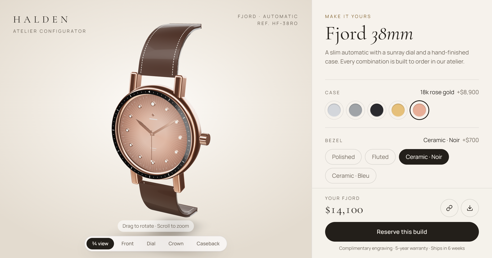
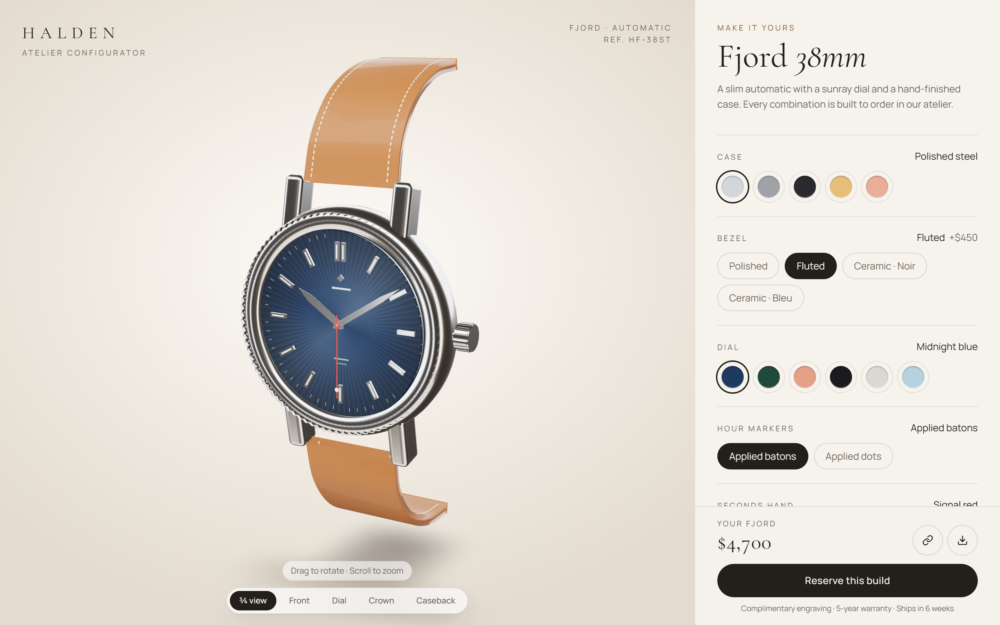
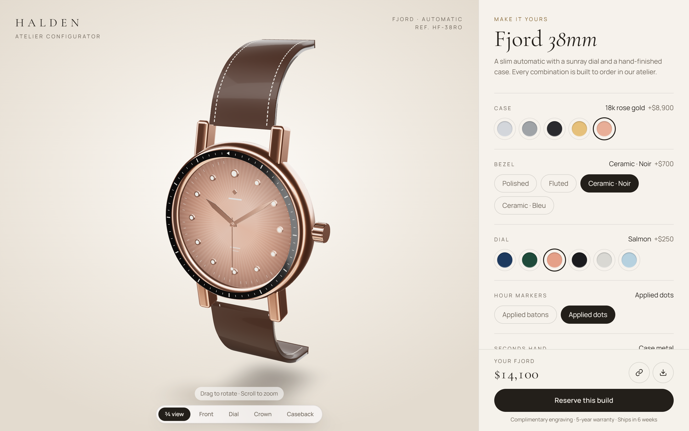
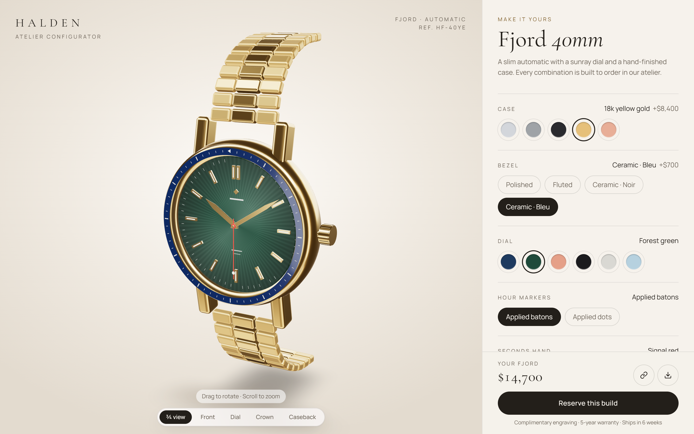
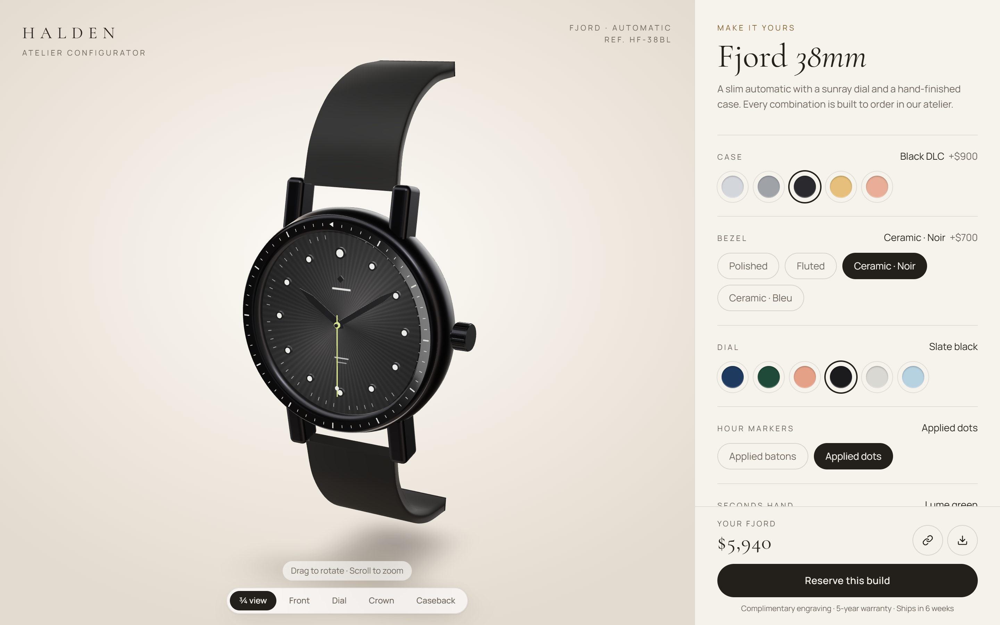
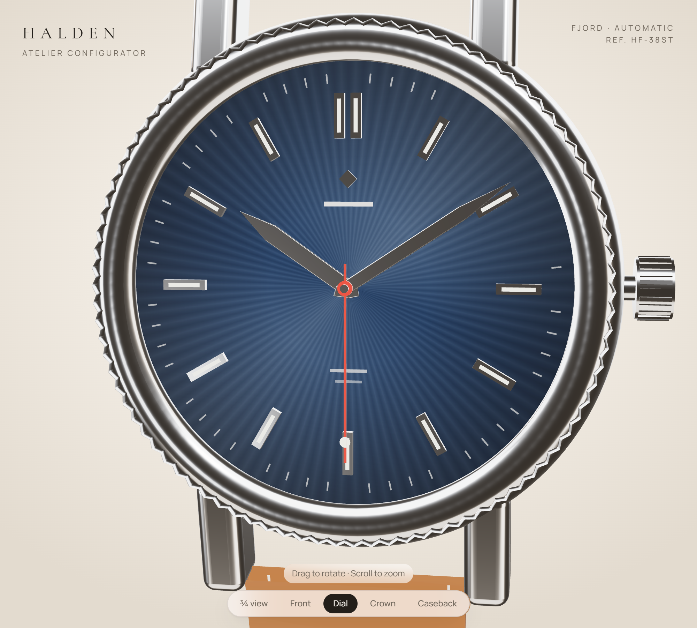
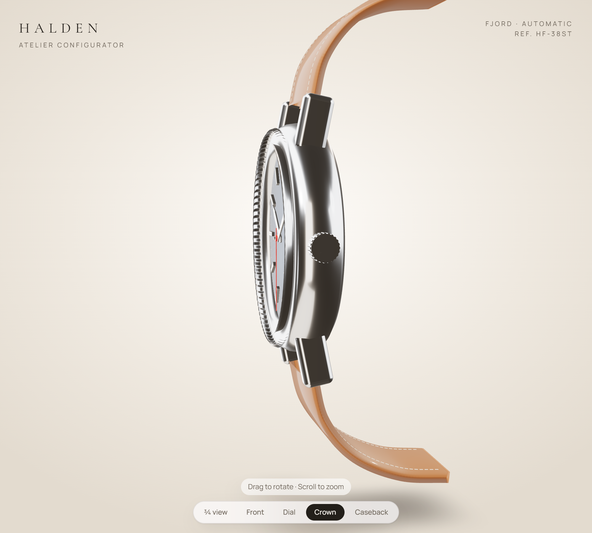
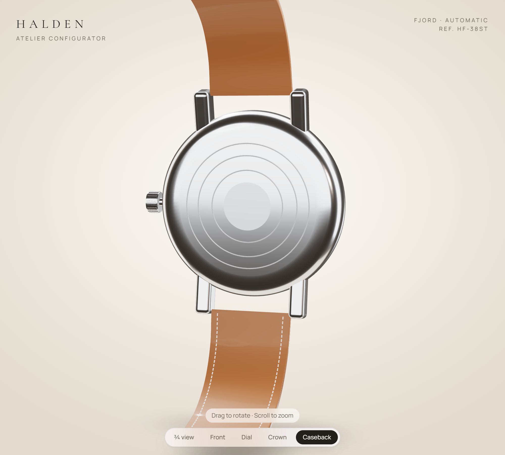
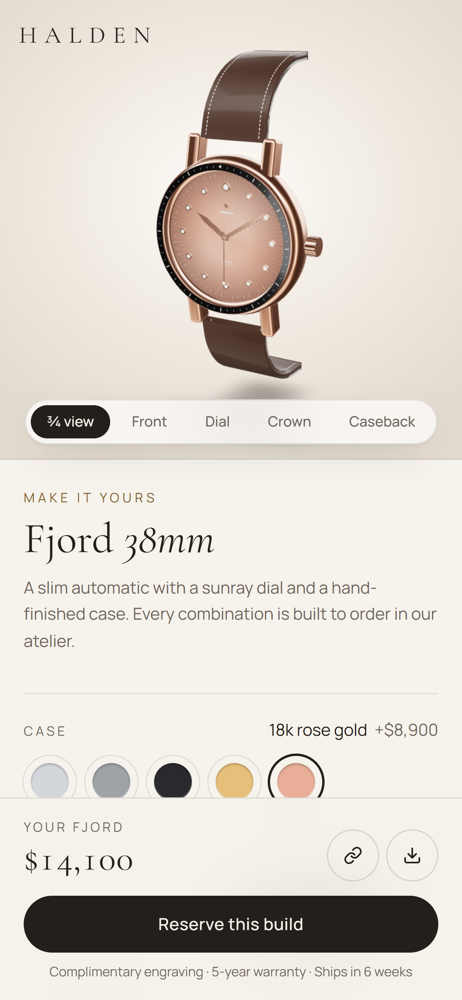
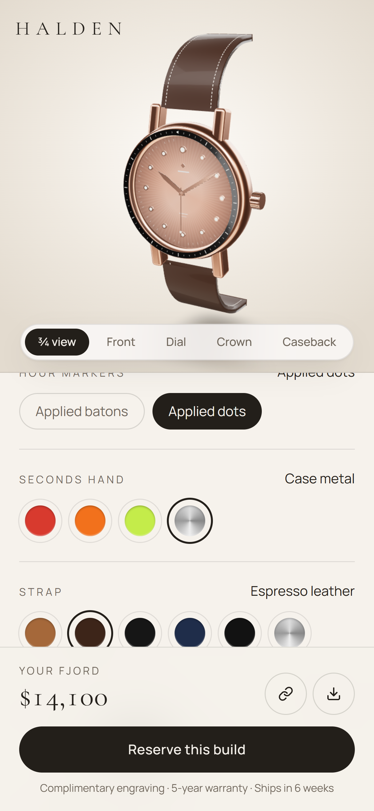

# Halden Fjord: 3D watch configurator

Design your own luxury watch in real-time 3D. Pick the case metal, bezel, dial, hour markers, seconds hand, strap and size; the price updates live, the address bar always holds a shareable link to your exact build, and you can save a studio-style image of it.

> Halden is a fictional watchmaker created for this portfolio project. The "Reserve" button doesn't place an order.



## Screenshots

| Signature steel | Rose gold |
|---|---|
|  |  |

| Yellow gold bracelet | Black DLC |
|---|---|
|  |  |

| Dial close-up | Crown profile | Caseback |
|---|---|---|
|  |  |  |

| Mobile preview | Mobile options |
|---|---|
|  |  |

The case study is in [`docs/case-study.md`](docs/case-study.md).

## Features
- **Fully procedural 3D model.** The case, fluted bezel, ceramic insert, dial, hands, crown, strap with stitching, and the linked bracelet are all generated in code. There are no model files to download or license.
- **17,280 combinations** across 5 case metals, 4 bezels, 6 dials, 2 marker styles, 4 seconds-hand colors, 6 straps and 3 sizes, with live pricing.
- **Real time on the dial:** the hands show your local time with a smooth automatic sweep.
- **Studio lighting generated in code** (drei Lightformers), with no HDR image download.
- **Camera presets:** ¾ view, front, dial close-up, crown profile and caseback, with smooth transitions. The camera also jumps to the most useful view when you change the dial, hands or strap.
- **Shareable builds:** every change updates the URL (`?case=rose&dial=salmon…`), and opening that link restores the exact watch.
- **Save image:** exports the current view as a PNG on a studio backdrop with a caption.
- **Mobile layout:** on phones the 3D view stays pinned at the top while the options scroll underneath.
- **Accessible:** the option buttons are real buttons with `aria-pressed` and labels that include price, everything is keyboard operable, and reduced motion is respected.

## Performance work
- **Parallel shader compilation.** The watch stays hidden for the first frames while every GPU program compiles in parallel (`renderer.compileAsync` + `KHR_parallel_shader_compile`), then fades in. This cut desktop Total Blocking Time from about 1,640 ms to about 360 ms.
- **Three.js loads separately** (`next/dynamic`, `ssr: false`), so the page and options render before the 3D code arrives.
- **Contact shadow renders once** per shape change instead of every frame.

## Lighthouse (production build)
| | Performance | Accessibility | Best Practices | SEO |
|---|---|---|---|---|
| Desktop | 83 | 100 | 100 | 100 |
| Mobile (simulated slow 4G + 4× CPU) | ~56 | 100 | 100 | 100 |

Mobile performance is limited by downloading and starting Three.js on a throttled CPU, which is the usual cost of real-time 3D on the web.

## Stack ($0)
Next.js 16 (App Router) · TypeScript · Tailwind CSS v4 · Three.js · React Three Fiber · drei · Vercel Hobby

## Run locally
```bash
npm install
npm run dev
```
Open http://localhost:3000. No environment variables or accounts are needed.

## Deploy
Import the repo on [vercel.com](https://vercel.com). `vercel.json` pins the framework to Next.js.

## Project structure
```
src/
  app/                     # layout, page, fonts, social preview image
  components/
    configurator.tsx       # options panel, price, share link, image export, views
    scene.tsx              # Canvas, studio lighting, camera rig, shader warm-up
    watch/
      watch.tsx            # the watch: case, bezel, dial, hands, crown, strap, bracelet
      geometry.ts          # procedural geometry (lathe profiles, flutes, strap band)
      dial-texture.ts      # sunray dial texture drawn on a canvas
  lib/
    config.ts              # options, prices, URL encoding
    views.ts               # camera presets
docs/
  thumbnail.png            # 1200×630 card (and @2x)
  screenshots/desktop/     # 1440px wide, 2× resolution
  screenshots/mobile/      # 390px wide, 3× resolution
  case-study.md
```

## What I learned
- **Procedural modeling is a superpower for configurators.** Revolving 2D profiles (lathes) gives a watch case and bezel in a few lines, and changing a profile or swapping a material is instant, with no 3D software needed.
- **Metal needs something dark to reflect.** My first version looked like grey plastic because the studio was evenly bright. Real product photography uses a dark room with softboxes, and the same trick works in 3D.
- **Shader compilation is the hidden cost of 3D on the web.** The first frame compiled a dozen GPU programs and froze the page for over a second. Compiling them in parallel before showing the watch fixed it.
- **The URL is free state management for sharing.** Encoding the build in query parameters gave shareable links, refresh-safe state and "back to my build" with almost no code.
- **Test 3D in a real renderer.** Headless screenshots caught framing, lighting and layout bugs that type checks never would.

_Edit these in your own words before sharing._
