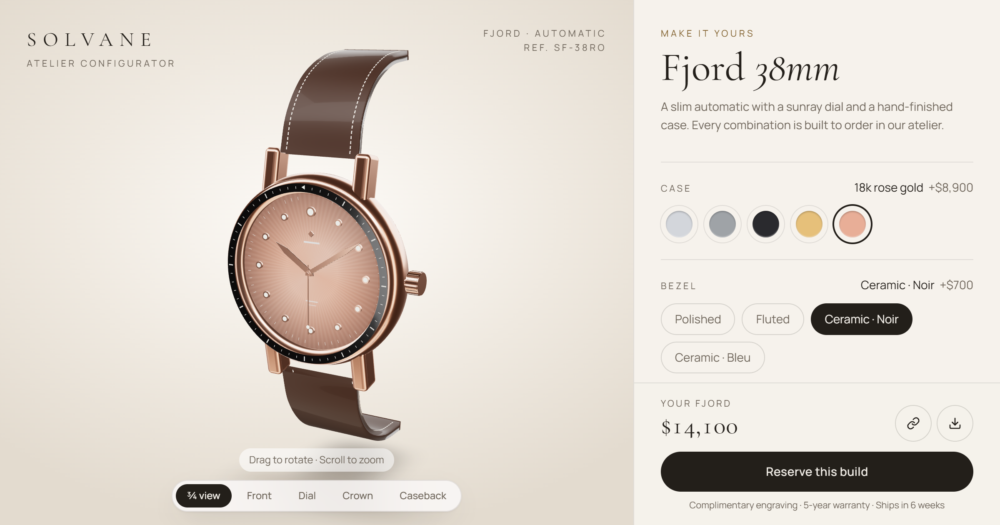
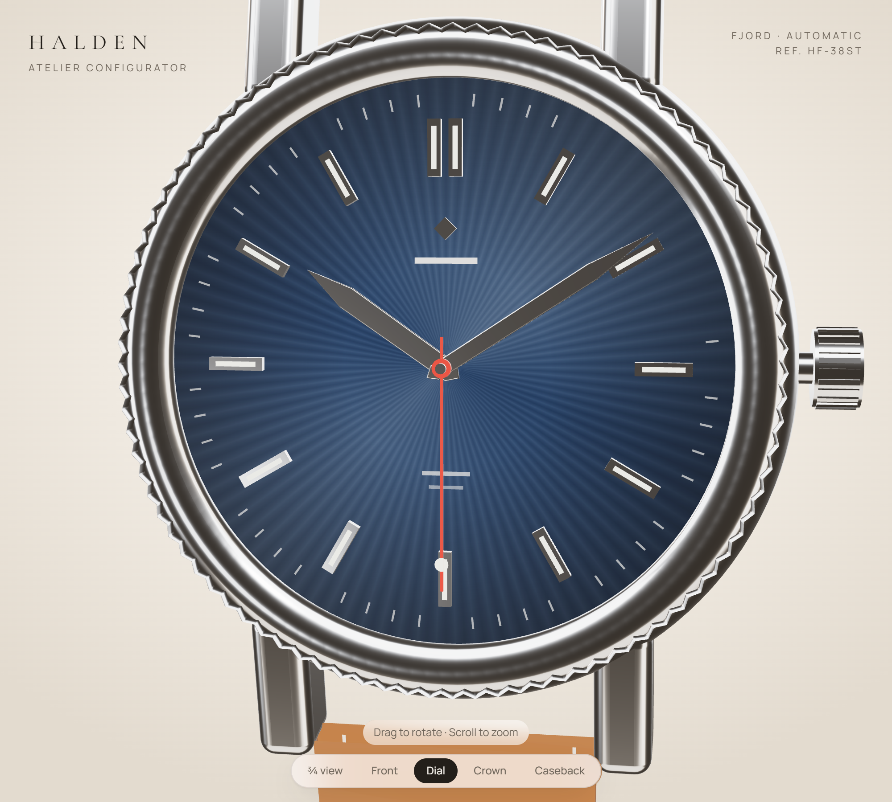
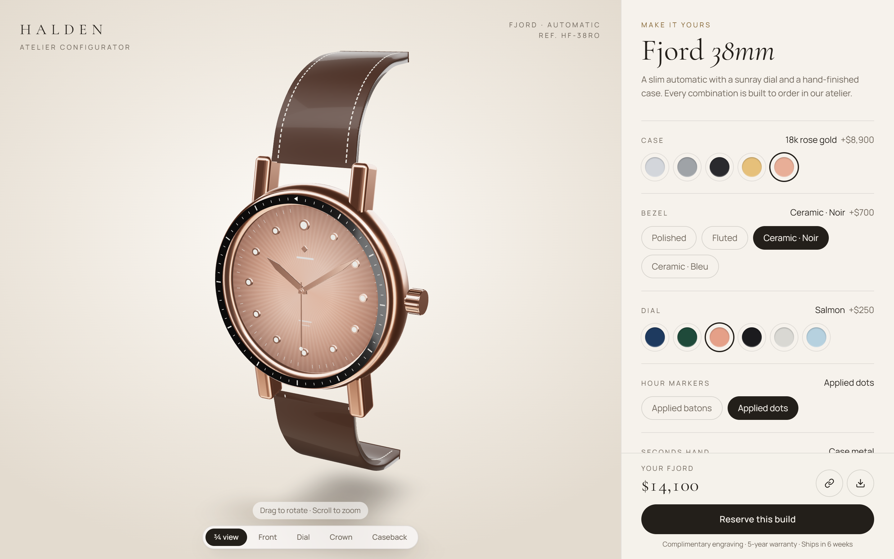
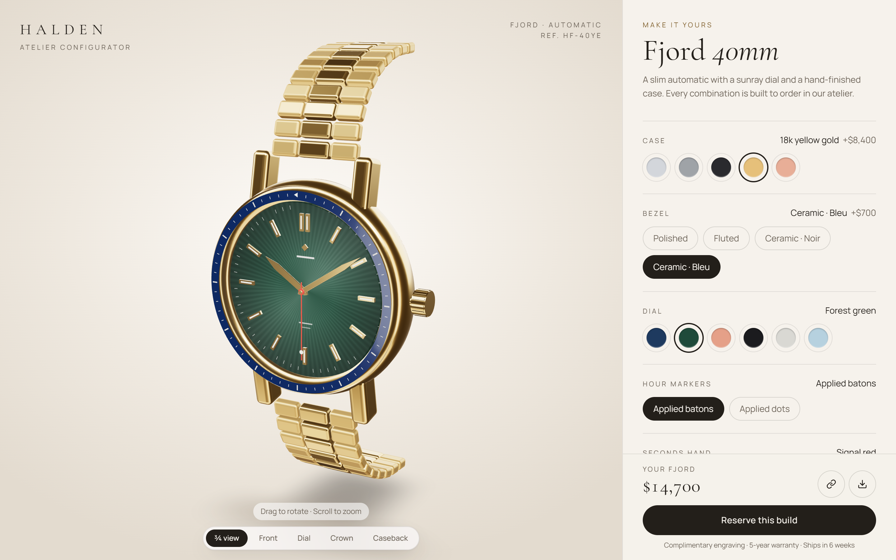
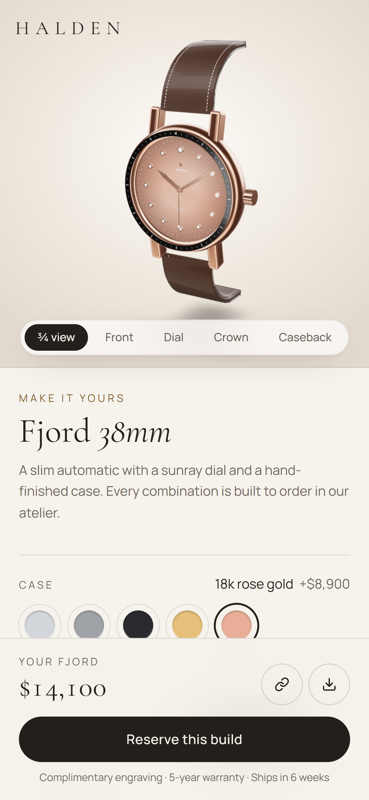
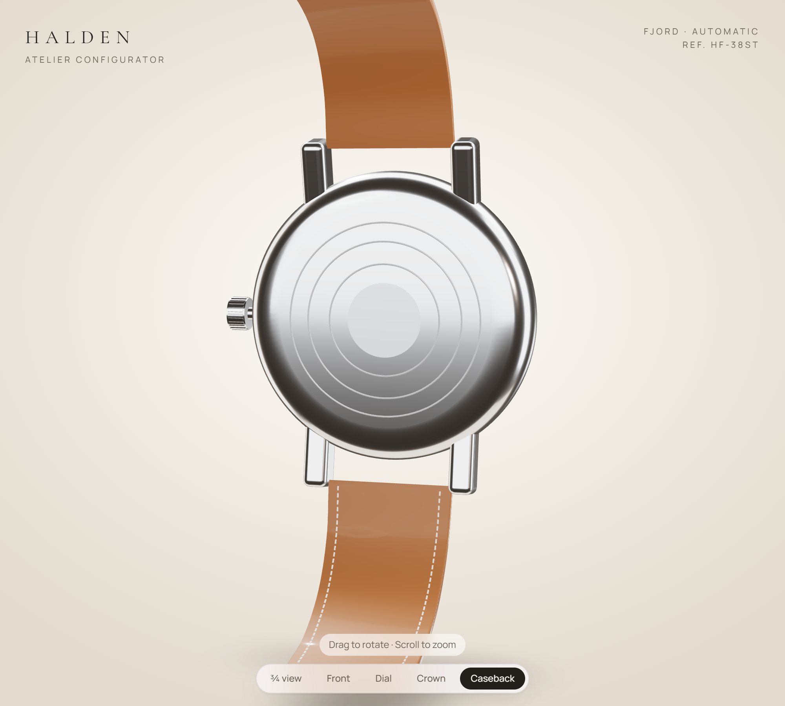
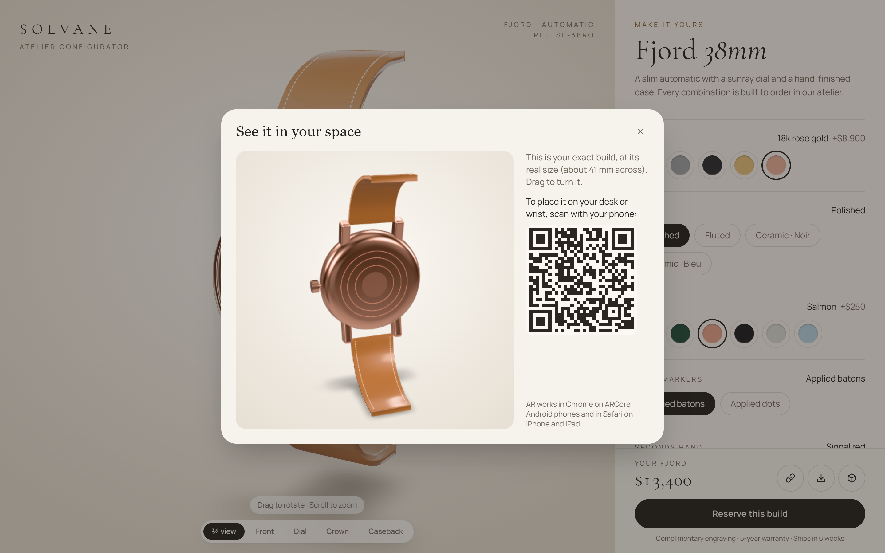

# Solvane Fjord: case study

**Role:** Design and development (solo)
**Type:** Interactive 3D product configurator
**Stack:** Next.js 16, TypeScript, Tailwind CSS v4, Three.js, React Three Fiber, drei, Vercel
**Links:** [Live site](https://solvane-watch-configurator.vercel.app) · [Code](https://github.com/shervs336/solvane-watch-configurator)

---

## Short version (for a portfolio card)

> A real-time 3D configurator for a fictional luxury watch. Every part (case, fluted bezel, sunray dial, hands, strap, bracelet) is generated in code, with live pricing, shareable build links, camera presets and image export. It has 17,280 possible combinations and no 3D model files.

---

## Problem

Premium brands increasingly let customers design products in 3D before buying. Doing it well is hard: the model has to look like the real thing (metal, ceramic, leather), it has to stay fast in a browser, and the experience has to work on a phone.

The goal was a configurator that feels like a luxury brand's site, built for $0 and without paying for or licensing a 3D model.

## Approach

- **Build the watch from code.** The case and bezel are revolved 2D profiles (lathe geometry). The flutes are cut by displacing the bezel's outer slope with a triangle wave. The strap is a band swept along a curve with stitching placed along it, and the bracelet is links oriented to the same curve.
- **Light it like a product photo.** A dark virtual studio with large softboxes (drei Lightformers) gives the metals real highlights and contrast without downloading an HDR image.
- **Make the UI feel like a boutique.** The page uses Cormorant Garamond with Manrope, a warm paper palette, and price and option names in the brand's voice.

## Key decisions

| Decision | Why |
|---|---|
| Procedural geometry instead of a downloaded model | No licensing, no large file to load, and every part can be swapped or recolored instantly. |
| Build state in the URL | Shareable links, refresh-safe state, and no backend needed. |
| `useSyncExternalStore` to read the URL | Reads the shared build without a hydration mismatch or an extra render. |
| Lazy-load the 3D scene | The panel, price and text render first; Three.js arrives separately. |
| Compile shaders in parallel before the first frame | Removed a 1.5-second freeze on load (desktop blocking time about 1,640 ms → 360 ms). |
| Camera jumps to the relevant view on change | Changing the dial zooms to the dial, so every choice is immediately visible. |
| Pinned 3D view on mobile | On phones, options scroll beneath the watch so you always see the result. |

## Details worth noticing

- The hands show your actual local time, with a smooth automatic sweep.
- The screenshots freeze the time at 10:09, the classic watch-advertising pose.
- The saved image composes the render onto a studio backdrop with the build name and price.
- The ceramic bezel insert has printed minute markers and a lume pip at 12.

| Rose gold | Yellow gold bracelet |
|---|---|
|  |  |

## Result

- A configurator with 17,280 combinations, live pricing, sharing and image export.
- Tested in a real browser: options, price math, URL sharing, reset, keyboard selection and image download all pass, with no sideways scroll on phones.
- **Lighthouse:** Desktop Performance 83, Accessibility 100, Best Practices 100, SEO 100. Mobile Accessibility, Best Practices and SEO 100, Performance around 56 on a simulated slow phone.

| Mobile | Caseback |
|---|---|
|  |  |

## What I'd do next

- **Engraving:** render custom text on the caseback.
- **Mobile performance:** load a lighter model first, then swap in full detail once it's idle.

## Added later: AR view

**See it in your space** exports the exact build to a binary glTF in the browser and opens it in `<model-viewer>`:
- **Real size:** the export is a clone of the scene graph, scaled so the watch is about 4.5 cm across, centered and resting on the floor plane. AR shows it as big as a real watch.
- **No server, no files:** the GLB is a blob URL. Android uses WebXR, and iPhone uses Quick Look, with model-viewer converting the glTF to USDZ on the device. The Scene Viewer app is left out because it can't open blob URLs.
- **From desktop to phone:** desktops can't do AR, so the dialog shows a QR code of the build's link with `?ar=1`, which opens the AR view straight away on the phone.
- **Checked:** the exported model passes the Khronos glTF validator with no errors or warnings. Placing it in AR needs a real phone; that part is untested here.

